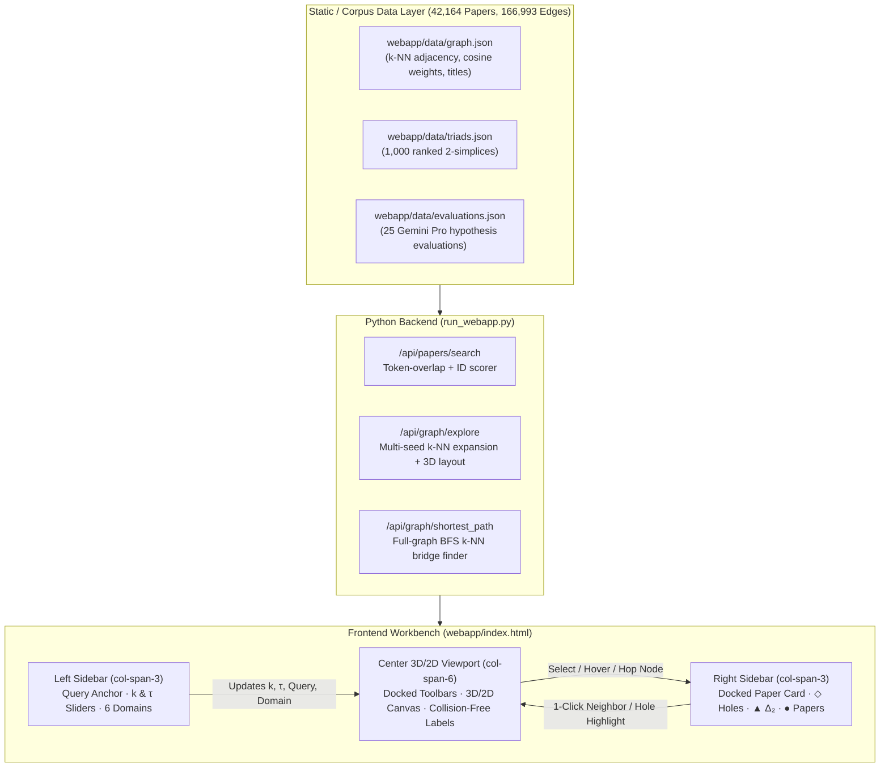

# Technical Design Document: 3D Interactive Simplicial Discovery Workbench

**Project**: `suchith720/paper_simplicial` (`/usr/local/google/home/gharats/paper_simplicial-main`)  
**Live Server**: `http://gharats.c.googlers.com:8501/?v=workbench` (or `http://localhost:8501`)

---

## 1. Executive Summary & Goals

### 1.1 Background
The original `paper_simplicial` web application provided static tables of top-ranked paper triads, Gemini Pro hypothesis evaluations, and a basic 2D `vis-network` widget limited to a single node neighborhood. While effective for inspecting pre-computed triads, users could not interactively **traverse** the literature hop-by-hop in 3D, filter simplices dynamically by cosine similarity threshold ($\tau$), or detect **open topological boundary holes** (unfilled triangles where a bridge paper connects two otherwise unlinked papers).

### 1.2 Design Goals
1. **Interactive 3D & 2D Simplicial Flag Complex**: Render 0-simplices (papers), 1-simplices ($k$-NN edges), closed 2-simplices ($\Delta_2$ triangles), closed 3-simplices ($\Delta_3$ tetrahedra), and open boundary holes ($\diamond$) in a smooth 60 FPS HTML5 Canvas engine with seamless $3\text{D} \leftrightarrow 2\text{D}$ morphing.
2. **Real-Time Vietoris–Rips / Clique Filtration**: Provide twin sliders for **$k$-Nearest Neighbors ($k \in [3, 30]$)** and **Simplicial Threshold ($\tau$)** (auto-calibrated to the local neighborhood's edge weight distribution) to watch simplices form and crack into open boundary holes in real time.
3. **Hop-by-Hop Query Traversal & Shortest $k$-NN Bridge Discovery**: Support multi-seed query constellations (`🌐 Top-3 Query`), breadcrumb trail history (`[`, `]`, `1`–`9` hotkeys), and BFS shortest-path bridge discovery (`🔗 Bridge Path`) across all 42,164 papers.
4. **Zero-Overlap 3-Column Workbench UI**: Eliminate floating HUD cards and cursor-blocking tooltips that previously obscured the 3D graph, replacing them with a dedicated 12-column (`3 / 6 / 3`) workbench with docked top/bottom toolbars and a right-sidebar **Selected Paper Description Card**.

---

## 2. System Architecture

---

## 3. Mathematical & Algorithmic Specification: Simplices & Holes

All higher-order structures in the active neighborhood are recomputed dynamically in `rebuildFiltrationSimplices()` (`webapp/index.html`) whenever the user adjusts the **$k$-NN ($k$)** slider, the **Simplicial Threshold ($\tau$)** slider, or hops to a new paper.

### 3.1 Step 0: Active 1-Skeleton Filtration ($G_\tau = (V, E_\tau)$)
Given the induced neighborhood vertex set $V$ (up to $k$ nearest neighbors per seed node, expanded over 1-hop and 2-hop shells in `expand_neighborhood()`) and its base $k$-NN edge set $E_{k\text{-NN}}$, the active edge set at filtration threshold $\tau$ is:

$$E_\tau = \{(u, v) \in E_{k\text{-NN}} \mid w(u, v) \ge \tau\}$$

where $w(u, v) \in [0, 1]$ is the embedding cosine similarity between papers $u$ and $v$.

#### Auto-Calibration of $\tau$ (`calibrateTauSlider()`)
Because local $k$-NN neighborhoods have cosine similarities concentrated in a narrow high-similarity band (e.g., $[0.9758, 0.9878]$), a fixed $[0.5, 1.0]$ slider would leave 98% of the slider track dead. `calibrateTauSlider(edges)` dynamically inspects `[minW, maxW]` of the active subgraph and sets:
- `tauRangeMin` $= \max(0.1, w_{\min} - 0.04(w_{\max} - w_{\min}))$
- `tauRangeMax` $= \min(0.9999, w_{\max})$
- `step` $= ( \text{tauRangeMax} - \text{tauRangeMin} ) / 140$

---

### 3.2 Closed Simplices ($\Delta_2$ Triangles & $\Delta_3$ Tetrahedra)

Using the **Vietoris–Rips / Clique (Flag) Complex** construction $\mathcal{K}(G_\tau)$, a subset of vertices $\sigma \subseteq V$ forms a closed $d$-simplex if and only if every pair of vertices in $\sigma$ is connected in $E_\tau$:

1. **Closed 2-Simplices ($\Delta_2$ — Filled Triangles)**:
   For every ordered triple $a < b < c$ in $V$:
   $$[a, b, c] \in \Delta_2(\tau) \iff (a, b) \in E_\tau \;\land\; (b, c) \in E_\tau \;\land\; (a, c) \in E_\tau$$
   Equivalently, $\min(w_{ab}, w_{bc}, w_{ac}) \ge \tau$. Each closed 2-simplex represents a mutually coherent 3-paper cluster and is rendered as a translucent filled triangular face in 3D/2D.

2. **Closed 3-Simplices ($\Delta_3$ — Tetrahedra)**:
   For each closed triangle $[a, b, c] \in \Delta_2(\tau)$ and every fourth vertex $d > c$ in $V$:
   $$[a, b, c, d] \in \Delta_3(\tau) \iff (a, d) \in E_\tau \;\land\; (b, d) \in E_\tau \;\land\; (c, d) \in E_\tau$$
   Each 4-clique forms a volumetric 3-simplex (tetrahedron) whose 4 triangular boundary faces are all closed in $\Delta_2(\tau)$.

3. **Euler Characteristic ($\chi$)**:
   Computed live in `rebuildFiltrationSimplices()` and displayed in the header invariant pill:
   $$\chi(\mathcal{K}_\tau) = |V| - |E_\tau| + |\Delta_2(\tau)| - |\Delta_3(\tau)|$$

---

### 3.3 Open Boundary Holes ("Unfilled Triangles" & $H_1$ Cycles)

In scientific literature discovery, a **closed 2-simplex** $[u, v, w]$ means all three papers are already mutually proximate in embedding space. By contrast, an **Open Boundary Hole ($\diamond$)** occurs when a pivot paper $v$ strongly connects to both $u$ and $w$ ($w_{uv} \ge \tau, w_{vw} \ge \tau$), but the closing edge $(u \dashleftrightarrow w)$ is absent in $E_\tau$ — signaling an **unbridged synthesis opportunity** between $u$ and $w$ mediated by $v$.

We detect open holes in two passes:

1. **Pass A — $\tau$-Filtration Boundary Holes**:
   - Inspects every base triangle $[a, b, c] \in \Delta_2(\tau_{\min})$ that is **no longer closed** at the current threshold $\tau$.
   - If exactly two of its edges remain active above $\tau$ — say $(u, v) \in E_\tau$ and $(v, w) \in E_\tau$ — while the third edge $(u, w)$ has $w_{uw} < \tau$, then $[u, v, w]$ is flagged as a **`τ-Filtration Boundary Hole`** with missing link $(u \dashleftrightarrow w)$.

2. **Pass B — $H_1$ 4-Cycle Topological Holes & Open $k$-NN Wedges**:
   - Iterates over every pivot node $v \in V$ and every pair of its active neighbors $u, w \in N_\tau(v)$ ($u < w$) such that $(u, w) \notin E_\tau$.
   - **$H_1$ 4-Cycle Test**: Checks whether $u$ and $w$ share a **second common neighbor** $v' \ne v$ in $E_\tau$. If so, $u - v - w - v' - u$ is a chordless 4-cycle ($H_1$ 1-cycle hole) where two independent bridge papers ($v$ and $v'$) link $u$ and $w$ without a direct $(u, w)$ edge.
   - Otherwise, $u - v - w$ is classified as an **`Open k-NN Wedge Gap`**.

3. **Synergy Scoring Formula**:
   $$\text{Score}(u, v, w) = \sqrt{w_{uv} \cdot w_{vw}} + 0.015 \cdot \mathbb{I}_{\tau\text{-opened}} + 0.010 \cdot \mathbb{I}_{4\text{-cycle}} + 0.005 \cdot \mathbb{I}_{\text{cross-domain}} + 0.006 \cdot \mathbb{I}_{\text{center}}$$

---

## 4. 3D & 2D Layout and Rendering Engine

### 4.1 Fixing the 3D Coordinate Collapse (`compute_3d_layout`)
- **Problem**: Initially, `compute_3d_layout` applied a strong triangle centroid attraction (`0.06`) against a weak repulsion (`2600 / d²`) without radial shell restoration. In triangle-dense subgraphs, all node coordinates collapsed from radius `135–215` down to `~35–42` units, shrinking the 3D graph into a tiny ~80px ball in the center of the canvas.
- **Solution (`compute_3d_layout` & `computeStatic3DLayout`)**:
  1. Initialized nodes on concentric Fibonacci spheres ($r = 0$ for center, $r = 75$ for extra seeds, $r = 135$ for 1-hop neighbors, $r = 215$ for 2-hop neighbors).
  2. Increased pairwise Coulomb repulsion to $11500 / (d^2 + 4)$, set target spring length to $135 \cdot (1.18 - 0.25 w_{uv})$, reduced triangle centroid cohesion to $0.015$, and added a **radial shell restoring force** $F_{\text{radial}} = 0.08 (r_{\text{shell}} - r_i)$.
  3. Normalized the relaxed 3D coordinates so $\max_i \|p_i\|_2 = 205.0$, expanding the 3D neighborhood by **4.5×** across the canvas.

### 4.2 Seamless $3\text{D} \leftrightarrow 2\text{D}$ Planar Morphing (`compute2DPlanarCoords`)
- **Problem**: Switching to `2D` previously hid `<canvas id="network-3d">`, hid `#controls-3d-bar` (making it impossible to click `3D` again), and relied on external `unpkg.com/vis-network` which failed inside CSP-restricted frames.
- **Solution**:
  - `compute2DPlanarCoords` computes a force-relaxed 2D concentric planar layout $(x_{2\text{D}}, y_{2\text{D}}, 0)$ for every node alongside its 3D coordinates $(x_{3\text{D}}, y_{3\text{D}}, z_{3\text{D}})$.
  - Clicking **`2D`** in `setGraphRenderMode('2d')` keeps `#controls-3d-bar` and `<canvas id="network-3d">` active, smoothly interpolates node targets $(t_x, t_y, t_z) \to (x_{2\text{D}}, y_{2\text{D}}, 0)$ and camera angles $(\text{yaw}, \text{pitch}) \to (0, 0)$, and switches mouse drag from 3D orbit to 2D pan.

### 4.3 2D Bounding-Box Collision Avoidance for Node Labels
- Labels are sorted front-to-back by visual priority (hovered $>$ selected $>$ active hole $>$ focal center $>$ query match $>$ `[1–9]` direct neighbors $>$ 2-hop nodes).
- Before drawing a non-focal label, its screen bounding rectangle $(l_x, l_y, b_w, b_h)$ is tested against `placedBoxes`; overlapping labels are suppressed and visible labels receive a translucent pill backdrop.

---

## 5. UI/UX Redesign: Zero-Overlap 3-Column Workbench

| UI Issue in Previous Layout | Root Cause | Redesigned Workbench Solution in `webapp/index.html` |
| :--- | :--- | :--- |
| **3D Graph Box Too Small** | Stacked multi-row top header + multi-row control panel ate vertical space; unnormalized 3D coordinates collapsed to radius `~40`. | Single-row compact header (`52px`) + 12-column workbench (`h-[740px]`) + **`⛶ Maximize`** button + `205`-unit normalized 3D radius. |
| **Paper Description Box Overlapped 3D Graph** | `#node-hud-card` (`420px` wide) was `position: absolute` inside the 3D canvas, and `#graph-tooltip` popped up right under the mouse cursor. | Moved **Selected Paper Description Card (`#inspector-paper-card`)** into the **Right Sidebar (`col-span-3`)** and replaced the floating cursor tooltip with a **docked 1-line bottom footer banner (`#canvas-hover-banner`)**. |
| **Top/Bottom Buttons Floated Over 3D Nodes** | `#traversal-bar` and `#controls-3d-bar` were `position: absolute` inside the 3D canvas. | Docked the Trail & 3D/2D Layer Controls in a dedicated **top header bar above `<canvas id="network-3d">`** and the hover/hint strip in a **bottom footer bar below the canvas**. |

---

## 6. Summary of Modified & Created Files

| File Path | Key Changes |
| :--- | :--- |
| `run_webapp.py` | • Added portable fallback loader `_load_from_static_bundle` for `webapp/data/graph.json`. • Added `compute_3d_layout` with radial shell restoration and `205.0`-radius normalization. • Upgraded `/api/graph/explore` for multi-seed constellations & query scoring. • Added `/api/graph/shortest_path` for full-graph BFS $k$-NN bridge paths. • Added `Cache-Control: no-store` in `AppHandler.end_headers`. |
| `webapp/index.html` | • Redesigned `#view-graph` into the **12-Column (`3 / 6 / 3`) Zero-Overlap Workbench**. • Added **Dark / Light Theme Toggle** (`applyTheme`) and **6-Domain Scientific Cluster Palette** (`DOMAIN_CLUSTERS`). • Added auto-calibrating **Simplicial Threshold ($\tau$) Slider** (`calibrateTauSlider`) & **Open Boundary Hole Detector** (`rebuildFiltrationSimplices`). • Added seamless **$3\text{D} \leftrightarrow 2\text{D}$ planar morphing** (`setGraphRenderMode`, `compute2DPlanarCoords`) & collision-free 3D labels. |
| `DESIGN_DOC_3D_SIMPLICIAL_WORKBENCH.md` | • Standalone Technical Design Document saved in the repository root. |
